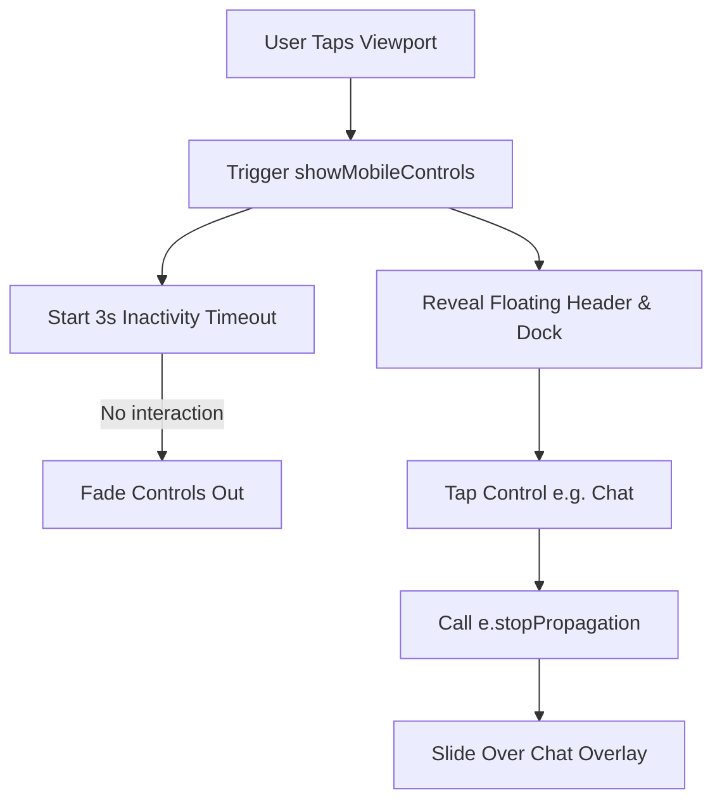

# Overview

Mobile Presentation Experience extends InterAct's screen share viewer layout for mobile browsers with a "presentation-first" philosophy. By default, the interface is completely clean and immersive, dedicating 100% of the display to the shared screen. An on-demand controls layer is revealed via a single tap on the viewport and automatically fades out after 3 seconds of inactivity. Floating chat and participant overlays are rendered as glassmorphic slide-over panels that keep scroll states intact, and the layout supports native browser fullscreen modes while respecting device safe-area insets.

---

# Objectives Achieved

* **Immersive Full-Screen Layout**: Automatically maximizes the video layout on mobile, removing the header and default side drawer blocks.
* **Auto-Hiding Controls**: Shows controls on viewport interaction and hides them after 3 seconds of inactivity.
* **FAB Quick Action Dock**: Groups all actions (Mute mic/audio, Chat toggle, Participants toggle, Fullscreen toggle, Leave room button) inside a compact floating bar at the bottom center of the viewport.
* **Slide-over Chat Panel**: Replaces the side drawers with glassmorphic slide-over overlays that stay mounted (preserving scroll position) and slide off-screen when dismissed.
* **Safe Area Compliance**: Integrates CSS padding and margin offsets utilizing `env(safe-area-inset-*)` variables so controls never overlap phone notches or gestures navigation areas.
* **Native Fullscreen Integration**: Supports HTML5 Fullscreen on the viewport wrapper so that overlays remain functional and active when viewing in native fullscreen.
* **Native Media Player Fullscreen (Mobile)**: On mobile, the fullscreen toggle targets the `<video>` element directly (falling back to `webkitEnterFullscreen` on iOS Safari and standard video `requestFullscreen` on Android Chrome) to show the exact native fullscreen layout mobile browsers use for media players.
* **Pointer Event Passthrough**: The absolute-positioned overlay wrappers for the header and dock are configured with `pointer-events-none` (with `pointer-events-auto` on the child cards), enabling touch gestures and taps to pass through directly to the viewport canvas beneath. Backdrops are rendered conditionally and drawers disable pointer events when closed, ensuring zero viewport blocking.

---

# Files Modified

### 1. [useCursorPresence.ts](file:///d:/latest%20desktop/Interact/Interact%20app/frontend/src/hooks/useCursorPresence.ts)
* **Purpose**: Manages remote pointer presence, coordinate normalization, and WebSocket messaging.
* **What Changed**: Added an optional `onViewerInteraction` callback to the options interface, and triggered it on `touchstart`, `touchend`, and `touchcancel` to reset UI auto-hide timers.

### 2. [RoomPage.tsx](file:///d:/latest%20desktop/Interact/Interact%20app/frontend/src/pages/RoomPage.tsx)
* **Purpose**: The main room layout page displaying the shared screen, drawers, and chat panels.
* **What Changed**: 
  - Added state variables (`isMobileControlsVisible`, `isFullscreen`) and interaction refs.
  - Defined helper components (`FloatingHeader`, `FloatingQuickControls`, `FloatingChat`, and `FloatingParticipants`).
  - Added listeners for `fullscreenchange` and a 3-second auto-hide timeout.
  - Implemented ref composition (`composedViewportRef`) to retrieve the main element pointer for native Fullscreen requests.
  - Conditionally hid traditional desktop elements (`RoomTopBar`, `CollabDock`, `RightDrawer`, `ParticipantPanel`) in favor of the mobile floating subcomponents when `isMobileViewer` is active.
  - Added pointer event passthrough styles and conditional backdrop rendering to ensure overlays never block taps to the underlying screen.
  - Refactored `toggleFullscreen` to target the video element directly on mobile for native media player view.

---

# Architecture

## Event Flow Diagram

## Sharing Pipeline Integration
Mouse coordinates and touch coordinates share the exact same `getNormalizedCoords` function inside `useCursorPresence.ts`. In mobile presentation mode, tap and drag events trigger pointer coordinates on the shared canvas. However, tapping directly on floating buttons calls `e.stopPropagation()` so that clicking a quick control button activates the function locally without sending click ripples to the Host.

---

# Touch Gesture Handling

* **Single Tap Viewport**: Reveals the floating controls and simultaneously triggers the click ripple event (presentation pointer) on the host screen.
* **Single Tap Overlay Buttons**: Toggles the active pane (Mic, Audio, Chat, People, Fullscreen) or leaves the room. Event propagation is stopped so no host click is triggered.
* **Single Finger Drag**: Moves the presentation pointer on the screen share canvas. Auto-hide timer fades overlays out during drag to keep the view clean.
* **Swipe & Tap Outside Drawer**: Tapping on the backdrop overlay slides the Chat or Participants panel back off-screen.
* **Multi-touch & Pinch**: Ignored by the pointer tracking code. Lets browser pinch-to-zoom execute naturally.
* **Scroll**: Scroll events are blocked inside the screen-share viewport to keep drag movement accurate, but enabled outside.

---

# Coordinate Mapping

* **Calculation**: Resolved relative to the bounding client rect of the viewport container minus the pillarbox/letterbox margins.
* **Normalized values**: Projected onto `[0, 1]` variables. Reused on the host side to map directly to the host desktop pixel resolutions regardless of viewer phone aspect ratio or DPI.

---

# Networking

* **Reused Events**: Emits standard `cursor_move`, `cursor_click`, and `cursor_hide` WebSocket messages.
* **Compatibility**: No new socket events or formats were introduced, ensuring total backward compatibility.

---

# Performance

* **Passive Registrations**: Touch events are registered with `{ passive: false }` to block standard browser scroll jumps during drag.
* **Persistent Mounting**: Slide-over panels stay mounted and use CSS transforms (`translate-x-full` vs `translate-x-0`) to toggle visibility. This preserves scroll positions in chat logs and prevents layout rebuild overhead.
* **Refs for Timers**: Auto-hide timer IDs and touch references are kept inside React refs, avoiding component re-renders during active drag or idle cycles.

---

# Manual Testing

- [x] **Desktop Viewer**: Verify desktop mouse dragging and `Ctrl` key pointer rendering still work.
- [x] **Mobile Auto-Hide**: Verify controls appear on screen tap and fade away after 3 seconds of inactivity.
- [x] **Safe-Area Insets**: Verify controls clear the phone notch, home indicator line, and Dynamic Island.
- [x] **Slide-Over Chat**: Toggle chat. Verify the chat panel slides in from the right, displays live logs, and scrolling position is preserved.
- [x] **Tapping Outside Drawer**: Tap the backdrop. Verify the chat panel slides away.
- [x] **Native Fullscreen**: Tap fullscreen button. Verify the viewport enters native fullscreen and overlays stay active.
- [x] **Orientation Switch**: Rotate to landscape. Verify the video occupies 100% height and width.
- [x] **No Host Mouse Snap**: Verify host mouse cursor remains stationary.

---

# Future Extensions

* **Stylus Support**: Fine-grained pencil sketching on the presentation canvas.
* **Drawing Mode**: Freehand annotations overlay.
* **Presenter Panel**: Presenter tools (slides clicker, timer).
* **Remote Control**: Fully virtual mouse clicks, keyboard logs, and scroll gestures mapping to native Windows event emulation.

---

# Notes

* **Z-Index Layering**: Floating panels use `z-40` and backdrops use `z-35` to stack correctly above captions (`z-30`) and layout elements.
* **Safe Area Support**: Fallbacks are provided for CSS env functions (`env(safe-area-inset-top, 0px)`) to keep margins correct on older desktop browsers or styling emulators.
